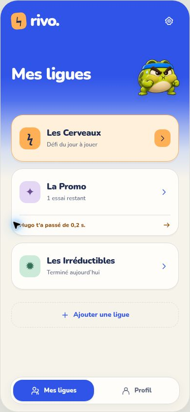

# Rivo — mini-jeux entre potes

La branche **`main` contient l’interface Rivo complète** : accueil « Mes ligues », parcours jouable, classements, invitations fictives, conversation et profil. La direction artistique validée utilise le bleu, le crème et la mandarine, avec la mascotte grenouille.

**L’ouverture du projet affiche directement Rivo.** Le code de l’interface et ses ressources sont dans [`rivo/`](rivo/README.md). Aucun paquet, compilation, compte ou clé API nécessaire pour essayer la démo.

## Récupérer et lancer le projet

Pour une première installation :

```sh
git clone https://github.com/alexdbs18/jeu-mobile-arcade.git
cd jeu-mobile-arcade
python -m http.server 8000
```

Ouvrir **http://localhost:8000/** : la page mène automatiquement à l’accueil **Mes ligues**. L’adresse directe **http://localhost:8000/rivo/** reste disponible. Sous Windows, utiliser `py -m http.server 8000` si `python` n’est pas reconnu. Arrêter avec Ctrl+C.

Si le dépôt est déjà sur l’ordinateur, enregistrer les modifications en cours sur sa branche avant de changer de branche, puis récupérer la version principale :

```sh
git switch main
git pull --ff-only origin main
```

On peut aussi télécharger **Code → Download ZIP** depuis la branche `main`, extraire le dossier puis y lancer le serveur.

Sur téléphone, utiliser le même Wi-Fi et ouvrir `http://ADRESSE_IP_DU_PC:8000/` (IPv4 affichée par `ipconfig` sous Windows). Pour repartir du début : roue dentée → **Réinitialiser la démo**.



## Où travailler

| Fichier ou dossier | Rôle |
| --- | --- |
| `index.html` | Ouvre directement Rivo |
| `rivo/app.js` | Écrans, navigation, données fictives et interactions |
| `rivo/style.css` | Composants et animations |
| `rivo/palette.css` | Couleurs validées et fond bleu-crème |
| `rivo/assets/` | Mascottes et polices locales |
| `rivo/docs/` | Aperçus et références visuelles |
| `games/_template/` | Point de départ pour les futurs mini-jeux |
| `docs/game-contract.md` | Convention d’intégration des mini-jeux |
| `tests/` | Vérification du point d’entrée et des ressources |

Le [guide détaillé de Rivo](rivo/README.md) décrit les fonctionnalités et les variantes de couleurs. Les jeux de démonstration servent à essayer le parcours. Les données restent sur l’appareil : les vrais comptes, ligues partagées et classements en ligne restent à développer.

## Développer à deux

Créer une branche depuis `main` (`interface/sujet`, `jeu/nom` ou `fix/sujet`), puis proposer une Pull Request. Voir [CONTRIBUTING.md](CONTRIBUTING.md).

Avec Node.js 22 ou supérieur, lancer `npm run check` avant de pousser : vérification de la syntaxe JavaScript, du point d’entrée et des ressources locales. GitHub exécute ces vérifications sur les Pull Requests et sur `main`.
