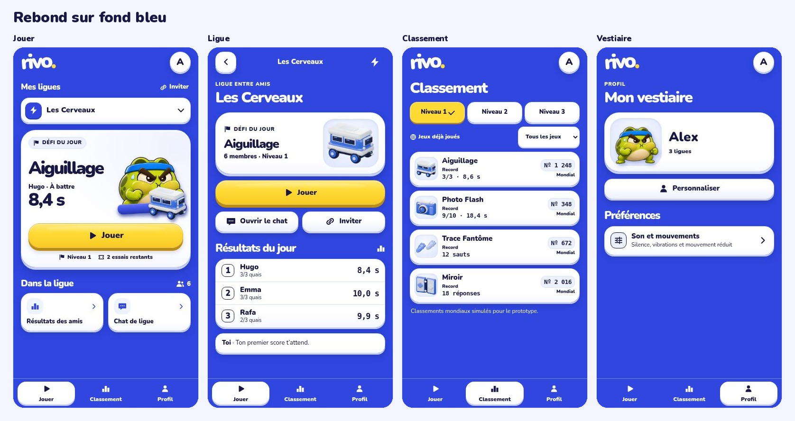

# Rivo · mini-jeux entre potes

Le prototype **Rebond** ouvre sur « Mes ligues ». Le fond bleu électrique, les cartes blanches en relief et les actions jaune solaire habillent le jeu, les ligues, les classements et le vestiaire.



## Essayer Rivo

Depuis la racine du dépôt, lancer le serveur local.

```sh
python -m http.server 8000
```

Ouvrir [http://localhost:8000/](http://localhost:8000/) ou [http://localhost:8000/rivo/](http://localhost:8000/rivo/). Sous Windows, `py -m http.server 8000` fonctionne aussi. Pour essayer sur téléphone, utiliser le même réseau Wi-Fi et ouvrir `http://ADRESSE_IP_DU_PC:8000/rivo/`.

Le fichier [rivo/index.html](rivo/index.html) embarque le prototype complet et s’ouvre aussi directement dans un navigateur.

## Continuer à deux

Le [guide de l’interface](rivo/README.md) explique où modifier le style, les écrans et les données de démo. Le [gabarit des mini-jeux](games/_template/) et le [contrat d’intégration](docs/game-contract.md) servent de point de départ pour un nouveau jeu.

Suivre le [guide de contribution](CONTRIBUTING.md) pour créer une branche et ouvrir une Pull Request. Lancer `npm run check` avant de pousser.
